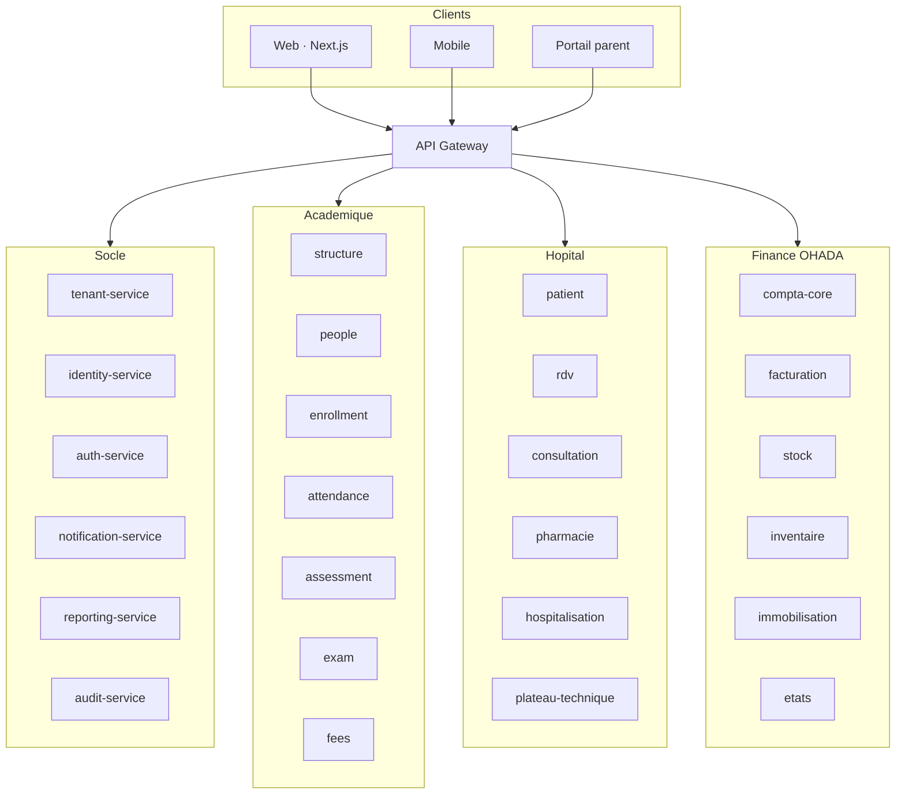
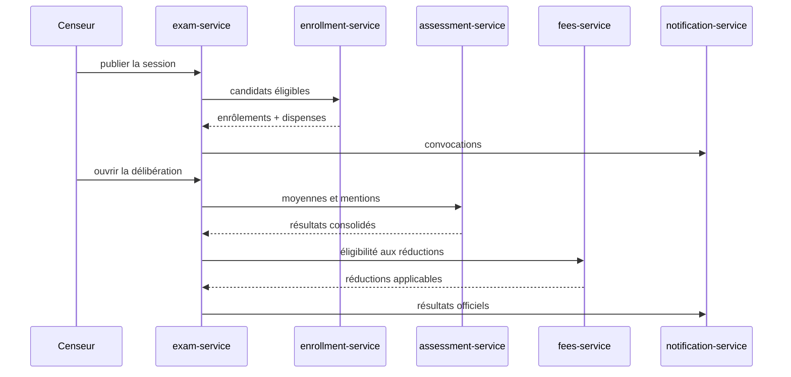
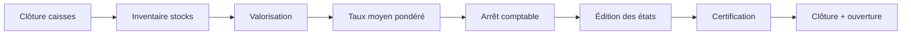
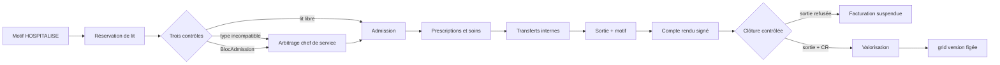
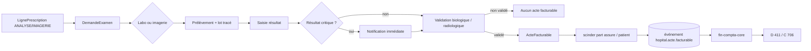
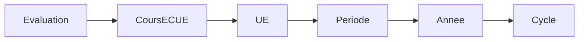

# Architecture NexusGesti

## Vue d'ensemble



## Flux : publication d'une session d'examen



## Flux : encaissement de frais

```mermaid
sequenceDiagram
  participant PAR as Parent
  participant FEE as fees-service
  participant ENR as enrollment-service
  participant BAN as Banque / Mobile Money
  participant CORE as compta-core
  participant NT as notification-service

  PAR->>FEE: POST paiements (Idempotency-Key)
  FEE->>ENR: vérifier inscription et blocage
  ENR-->>FEE: valide
  FEE->>BAN: mobile money / virement
  BAN-->>FEE: confirmation
  FEE->>CORE: événement comptabilisation
  CORE-->>FEE: accusé
  FEE->>NT: coupon généré
  FEE-->>PAR: reçu + coupon (QR, SHA-256)
```

## Flux : clôture d'exercice comptable



Chaque étape est **bloquante** : on ne certifie pas un bilan sans inventaire, on ne clôt pas sans états certifiés.

## Flux : parcours d'hospitalisation



Le périmètre du service est **le séjour** : lit, mouvements internes, sortie, valorisation. Les observations quotidiennes et les transmissions ne sont pas dans ce périmètre.

## Flux : d'un examen à la facture



**Le module hospitalier n'encaisse rien.** Il émet un acte facturable ; la comptabilise et le recouvrement restent dans `fin-compta-core` et `fin-facturation-service`. Même mécanisme que le paiement de frais scolaires, par topic d'événements.

Deux garde-fous structurants :

- **Rien ne sort avant validation.** Un résultat saisi mais non validé biologiquement n'est pas lisible du prescripteur, ne figure sur aucun compte rendu et ne déclenche aucune facture.
- **Pas d'examen sans équipement calibré.** Un scanner dont la date de calibration est dépassée ne produit aucun acte facturable.

## Multi-tenancy

Deux modes cohabitent :

| Mode | Isolation | Cible |
|---|---|---|
| **SaaS mutualisé** | `etablissement_id` sur chaque table, RLS PostgreSQL | petits établissements |
| **On-premise dédié** | base dédiée par instance | grands groupes, données sensibles |

Le `tenant-service` porte le `Etablissement`, son `ProfilEtablissement` et ses référentiels. Un profil **PRIMAIRE**, **SECONDAIRE** ou **UNIVERSITAIRE** active des règles du cœur pédagogique sans le dupliquer.

## Versionnement des règles métier

Aucune valeur en dur dans les services. Les règles sont des **données** :

- `GrilleNotation` — coefficients, cascade de pondération, seuils de mention, règles de rattrapage
- `GrilleTarifaire` — montants, plafonds, remises, tranches
- `RegleAssiduite` — seuils d'absence et de retard
- `GrilleStock` — durée de quarantaine, stratégie de rotation des lots, seuils d'alerte, tolérance d'écart d'inventaire, délai de réapprovisionnement
- `GrilleConformite` — durées de rétention, conservation des résultats et des images, chiffrement au repos, traçabilité des accès, délai de déclaration d'un résultat critique

Quatre sont définies dans `socle/modele-tenant-service.puml` ; `GrilleTarifaire` appartient à
`pedagogie/modele-academic-fees-service.puml`. Toutes portent le même cycle `activer()` / `figer()`.

Une correction crée une **nouvelle version** : les pièces déjà émises conservent leur version d'origine. Une ligne de tarification hospitalière fige sa version de grille à l'admission, une ligne de prescription fige celle de la demande, un lot fige celle de la règle de rotation qui lui a été appliquée.

## Cascade de pondération



La cascade active dépend du profil :

- **PRIMAIRE / SECONDAIRE** — `matière → période → année → cycle`
- **UNIVERSITAIRE** — `coursECUE → UE → semestre → cycle`

Les coefficients sont résolus par spécificité décroissante. Le détail de pondération est opposable : il est imprimé sur le bulletin.

## Conformité OHADA / SYSCOHADA (RDC)

- Devise fonctionnelle **USD**, devise légale d'affichage **CDF**
- Taux moyen pondéré figé à la clôture : `(achats + ventes) / volumes`
- Plan de comptes par classes 1 à 7
- États SYSCOHADA : bilan, compte de résultat, tableau de financement, état de trésorerie, charges par nature
- États **certifiés** (signature numérique, non régénérables), seuls acceptés par l'administration fiscale
- **FEC** exportable à la demande
- TVA : 0 % / 5 % / 10 % / 16 %, calculée par ligne

## Traçabilité

Toute action sensible (consultation de dossier médical, lecture de résultat, encaissement, publication de bulletin, cession d'immobilisation) émet un événement vers `audit-service`, qui journalise **acteur, motif, horodatage et périmètre consulté**.

`GrilleConformite.accesTracable` impose cette émission à chaque lecture de donnée de santé. Ce drapeau ne se désactive pas sur un profil `HOSPITAL`.

## Pile technique

| Couche | Choix |
|---|---|
| Backend | Java 21, Spring Boot 3.4, Maven multi-modules, architecture hexagonale |
| Persistance | PostgreSQL 16, Flyway, RLS pour l'isolation tenant |
| Sécurité | Keycloak (OIDC), JWT, Refresh Token rotation |
| Événements | Apache Kafka |
| Cache | Redis |
| Frontend | Next.js 16, React 19, TypeScript, Tailwind v4 |
| Diagrammes | PlantUML, moteur de rendu smetana |